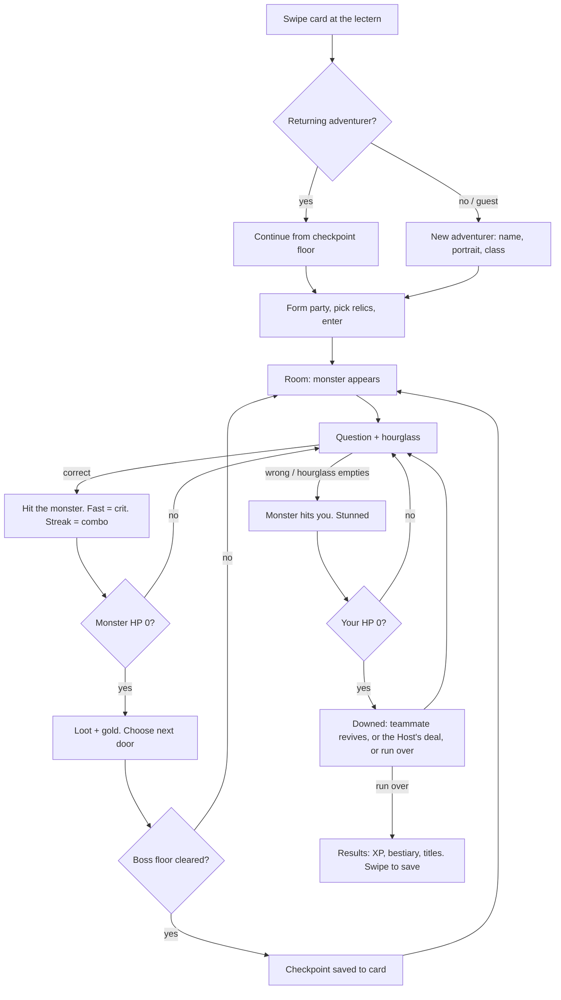

# Dungeon Quiz Quest: design bible and migration plan (v0.1, brainstorm)

Working draft for Brett and Mike to argue over. Everything below is an idea to keep, cut or expand;
the "Decisions needed" list at the end is what blocks building.

**Built so far (phase 1 slice, branch `feature/dungeon`):** Dungeon format on the existing engine:
monsters with HP, damage by difficulty, crits for fast answers, combos for streaks, the monster's
hourglass, getting hit for wrong or slow answers, being downed and getting back up, floors and a
Depth 1 boss from `config/dungeon.json`, endless deeper loops. The station screen follows the
reference layout; the main screen shows a lane per adventurer or party; a `dungeon` theme with pixel
fonts, placeholder pixel monsters and the Host's first lines. A party (a team, or a solo player) shares
one monster and floor, and each member keeps their own HP (`DungeonRun`). Groups play a fixed round;
a solo game runs on the arcade clock (kills add time, up to a hard cap), all set on the Operator
screen. When a solo clock runs out, "Continue?" counts down: a swipe adds time (for now from the dev
buttons page or the Operator screen). Parties revive their downed members (3 right answers; the downed
player shouts answers from a teammate's question meanwhile), land party combos, and get one lane per
party on the main screen. Between questions a battle beat plays the fight full screen (your knight's
strike, crits and combos, kills bursting apart, the way down to the next floor, the boss reveal, the
monster clawing you), banners sweep the main screen for the big moments, and placeholder 8-bit sounds
play on each station's speaker. Not yet: the station card readers, the fifth button, power-ups, cards as adventurers, heroes, doors, voice, real art.

**Experience design** (the why: the "a-ha" moment, power acquisition, the Host as the story, the
objectives and how they're measured): `docs/DUNGEON-QUIZ-QUEST-experience-design.pdf`. Following it so
far: after a wrong answer the right one flips over like a card in the middle of the fight (finding out
is a reward too), and kills shower gold. **Art direction:** 3D models that read like 2D paintings
(think Hearthstone). A first pass of the 3D fight runs on CC0 placeholder models (`js/battle3d/`,
the stations' default, preview at `/dev/battle3d`); the knight's gear comes as swappable parts, ready
for loot and power-ups to show on the hero. The station's question screen now follows the design lead's
example (`docs/design/station-example.png`), and the Host has a name and a face on the main screen:
**Q.U.E.R.I.E.** (Quantum Universal Engine for Research, Innovation, and Experimentation), placeholder
art and first lines in `copy.json`. Still open from the full doc: character classes (Rogue, Tank, Healer,
Wizard, Warlock, Pugilist, Ranger), whether damage should decay smoothly with answer speed instead of the
3-second crit, the four-button mini-games, operator-programmable events ("Trivia Night"), and how the
doc's four-button cabinet squares with the fifth action button.

**Bottom line on the software: keep it.** The room server, buttons and lights, room audio, kiosk and
RFID cards, question bank and admin, several groups at once, the live log: none of it cares what genre
it's dressed in. Dungeon Quiz Quest is a new game layer (combat, floors, progression), a new look, and a
host script on top of what exists. Not a rewrite.

---

## Direction update (30 Oct 2026): a run you push through, not a speed battle

The slice is still the 60-second speed battle in costume: every match is a fixed clock, and being
downed is a free 5-second pause, so nothing you do changes how long you play. From here, the game is
a run you push through, with time you earn, power-ups and choices. It must work as well for a group
as for one player: the social side is vital.

**Decided (Brett):**
- **A fifth button on each podium:** a general action button, not only for power-ups. First job: use
  your power-up. Later: ready up, confirm a continue, confirm a vote, with no more hardware changes. It
  lights up whenever pressing it would do something.
- **Group clock:** any match with 2 or more players (2v2, co-op, group free-for-all) has a fixed round
  length set on the Operator screen. Everyone starts and ends together. Kills earn points, loot and
  power-ups, not time.
- **Solo clock:** the same clock, but it stretches like a classic arcade game. Kills, bosses and Time
  Crystals add time. When it runs out, a "Continue?" countdown: swipe to add time and carry on from the
  same floor and HP; no swipe, results. The most a solo game can last is a backend setting.
- **Swipe to continue:** a card reader at each station.
- **Sabotage:** only between sides of the same group match (Party Race, group free-for-all). Never in a
  solo game. A solo player is their own match, so a group playing next to them can't reach them.
- **The party owns the run.** A solo player is a party of one, so solo and group play share one set of
  rules. Party members share the monster and floor, and each keeps their own HP. (Built.)

**Operator settings:** round length (groups); solo starting time, time per monster, time per boss and
the longest a solo game can last (the hard cap, continues included); time per continue (0 = none)
and the continue countdown. Done.

**Social mechanics** (switch on in parties of 2 or more):
- **Revives:** a downed player's screen shows a teammate's question so they can shout the answer;
  teammates' correct answers bring them back.
- **Party combo:** everyone answers right within a few seconds of each other: a bonus hit.
- **Votes:** boons and doors are picked by the party with their buttons, which gets them talking.
- **Power-ups aimed at people,** targeted automatically (the teammate most in need, the leading rival).
- The main screen and the Host call out the big moments for the room and the queue.

**Power-ups (v1):** monsters drop them and a streak of 5 earns one. One slot; the action button lights.

| For | Power-ups |
|---|---|
| Anyone | Potion (heal), Fireball (big hit), Freeze (stops the hourglass), 50/50, Shield (next miss free), Skip |
| Solo only | Time Crystal (+time) |
| Co-op | Heal Ally, Revive, Phone a Friend |
| Group matches only | Fog Bomb, Tiny Hourglass |

For 50/50 the server sends only which answers to hide, never the correct one (the `SnapshotBuilder` rule).

**Boons:** after each floor, pick one of three on buttons A to C (a party votes): more HP, more
damage, more time (solo), or a power-up. The clock pauses; after 8 seconds one is picked.

**Build order** (each step ends in a playable build):
1. Done: `DungeonRun` split out of `MatchEngine`; parties share the monster and floor.
2. Done: the clock: fixed for groups, stretchable for solo, the Operator settings and the hard cap.
   Starting defaults: 90 s solo start, +10 s a monster, +30 s a boss, 8 minutes at most.
3. Done: the Continue screen, triggered from the dev buttons page or the Operator screen ("Give a
   continue") until the station card readers exist. Defaults: +60 s a continue, 10 s to swipe.
4. Done: revives and party combos, and a lane per party on the main screen. In a party a downed
   member waits for 3 right answers from teammates (20 s at most); if the whole party goes down,
   everyone is back in 5 s. A party combo (everyone right within 4 s) doubles that hit.
5. Playtest: solo, then a group of four. Both have to be fun before going further.
6. Done: fifth-button wiring: button ids 26 to 29 (10 to 25 stay as they are), LED registers 216 to 219,
   keyboard stand-in keys 5 / T / G / B (5 or Enter on a station screen), the dev buttons page. Kept after
   the design doc's four-button box came up (Brett, 2 Nov 2026).
7. Done (v1): power-ups. Potion, Fireball, Freeze, 50/50, Shield, Time Crystal (solo). A kill drops one
   35% of the time (a boss always), a streak of 5 earns one; one slot; the action button lights while
   you hold one. Not yet: the co-op and group-only ones (Heal Ally, Phone a Friend, Fog Bomb, Tiny
   Hourglass), and power-ups aimed at rivals.
8. Boons and doors by party vote.

**Hardware to build:** a fifth button with an LED on each podium, and a card reader at each station.

---

## 1. What the reference images call for

**Station screen (portrait, `ReferenceImages/image.png`)**
- Enemy nameplate and HP bar on chains at the top ("GOBLIN BANDIT").
- The question on a parchment scroll.
- The monster in a torch-lit dungeon room, centre stage.
- Four answers, each with a coloured rune that matches its physical button (red, blue, green, yellow).
- A vertical hourglass timer down the left edge.
- The player plate at the bottom: portrait, handle ("SIR_QUESTALOT"), HP bar.
- 16-bit pixel art throughout.

**The room (`ReferenceImages/image (5).png`)**
- Stone archway with the "DUNGEON QUIZ QUEST" sign; torches, vines, flagstone floor.
- Four treasure-chest podiums with the four coloured buttons, each with a framed portrait screen above.
- Main screen: "PREPARE TO QUEST!", two parties of portraits with VS, the dungeon map, the difficulty.
- The kiosk is a lectern with an open spellbook.

---

## 2. What we keep, and what it becomes

| Today | Becomes | Work |
|---|---|---|
| Room server, SignalR, screens follow the server | Same | None |
| Several groups in one room at once | Several parties delving side by side | None |
| Timed rapid-fire round, own questions per player (`QuestionStream`) | The combat loop: every correct answer is a hit | Small: reuse inside a new engine |
| Wrong-answer lockout | "Stunned" | Rename |
| Game modes (FFA, 2v2 Group, 2v2 Combined) | Solo delve, party race, co-op, brawl (section 4) | New mode classes |
| Kiosk + RFID cards + player profiles | The lectern spellbook; your card is your adventurer | Extend profiles a lot |
| Question bank, categories, admin, import | Categories become dungeon realms; questions get tags and types | Extend |
| Theme system (`theme.css` + `copy.json` with random line variants) | `copy.json` is already a host-script engine; themes become floor biomes | Repurpose |
| Synced intro (server clock) | Depth intros, boss reveals, deaths, cutscenes | Reuse |
| PLC buttons and lighting | Torch flicker, hit flashes per podium, boss lighting | New cues |
| Room audio (7.1, each station has its own speaker) | Your hits and the monster's attacks on your podium speaker; host and music in the room | New sounds |
| Leaderboards | Deepest delvers, fastest boss kills, raid damage | Extend |
| Admin, Operator, Live log | Same, plus content and analytics tabs | Extend |
| Neon / Vegas / Showcase themes | Retired for this room (could stay for other venues) | Remove |

---

## 3. Pillars (the line between theme and quiz show)

1. **Quiz first, dungeon dressed.** Four buttons, answer fast, same as today. Every dungeon element must
   read in two seconds without lore: your HP bar is "how am I doing", the monster's HP bar is "how close
   am I", the floor number is your score.
2. **No stats screens during a run.** Depth (classes, relics, collections) lives on the card and at
   the lectern, between runs. Quiz-only players never have to touch it; RPG fans can go deep.
3. **The host is the star.** A charismatic, unhinged AI showrunner. Dungeon Crawler Carl's System AI
   crossed with a game-show host. It roasts performance, never people.
4. **Knowledge is a weapon.** The transformation goal made literal: what you know hits harder; a
   category you're good at is a weapon you choose to bring.
5. **Come back deeper.** Every visit ends with something saved: depth reached, XP, a monster in your
   bestiary, a title. "Swipe to continue."
6. **Better together.** Parties, revives, guilds, a community raid boss: the prosocial heart
   triggers (status, bonding, conversational currency) as mechanics.

---

## 4. The core loop

**Combat in one paragraph:** each monster has HP. A correct answer hits it: damage scales with
difficulty, a fast answer crits, and a streak of 3 builds a combo that unleashes a special attack. The
hourglass is the monster's attack timer: let it run out, or answer wrong, and the monster hits you and
you're stunned for a moment (today's lockout). Monster down: loot, then the next room. You at 0 HP:
downed (see "Death" below).

**Run length:** a paid play is one "Delve", capped by time (about 4 to 6 minutes) so throughput stays
predictable. The Delve ends when the time runs out or the party falls; whatever depth you reached
is saved.

### Modes

| Mode | Players | How it plays |
|---|---|---|
| Solo Delve | 1 | You against the dungeon. The Host is your only company (and your worst enemy). |
| Party Race | 2v2 | The "VS" on the reference main screen: two parties delve the same floors; deepest when time runs out wins. Sabotage events hit the other party. |
| Co-op Party | 2 to 4 | One party, one shared monster per room, revives. Gentlest for families. |
| Loot Brawl | 4 | Everyone hits the same monster; the killing blow takes the loot. Chaotic. |
| Raid | 4 | One boss with huge HP and phases. Weekly boss also feeds the community raid (section 8). |

### Death

- **Party:** a downed player sits out while a teammate answers to revive them (3 correct in a row).
- **Solo:** the Host offers a deal: "Answer this HARD one and I'll bring you back. Miss, and I keep your
  gold." A great moment for the Host's personality.
- **Run over:** you lose the gold you were carrying, keep XP and your checkpoint.

---

## 5. Floor pathing: the dungeon map

### Depths and biomes

Floors come in Depths of five; floor 5 of each Depth is a boss and a checkpoint. Each Depth leans on a
question realm (its categories), has its own art, music, monsters and Host bits. Categories become places.

| Depth | Name idea | Question realm | Monsters | Boss idea |
|---|---|---|---|---|
| 1 | The Cellar of Common Knowledge | General knowledge, easy | Rats, slimes, goblin bandits | The Goblin Quizmaster |
| 2 | The Pop Culture Catacombs | Movies, TV, music | Skeleton DJ, mummy influencer, banshee karaoke | The Lich of Reboots |
| 3 | The Flooded Archives | History, geography | Drowned librarian, kraken cartographer | The Kraken of Capitals |
| 4 | The Fungal Labs | Science and nature | Mushroom alchemists, spore golems | Dr. Mycelium |
| 5 | The Arcade Abyss | Video games, millennial | Glitch wraiths, 8-bit ghosts | The Final Boss (literally named that) |
| 6 | The Infernal Food Court | Food and drink | Grease elementals, sommelier vampire | Chef Lucifer (F&B tie-in) |
| Bottom | The Studio | Everything, hard | Stagehands, interns | The Host itself (seasonal finale) |

Difficulty climbs with depth: easy questions near the top, hard ones at the bottom. A "Gauntlet"
setting mixes all realms for regulars.

### Doors (choosing the path)

At the end of each room, two or three doors appear and the party votes with the buttons (A to D).
On the main screen it reads like a Slay the Spire map. Door types:

| Room | What happens |
|---|---|
| Monster | Standard fight. |
| Elite | Harder questions, an affix (below), double loot. |
| Treasure | Lightning round: 5 answers in 10 seconds opens the chest. |
| Trap | True/false sprint (2 buttons); each miss costs HP. |
| Shrine | Bet your gold on one hard question: double or nothing. |
| Merchant | Spend gold on potions, scrolls, a revive. |
| Campfire | Heal, or upgrade a relic. |
| Mystery | A Host game-show segment (below). |
| Realm door | "Next room: Movies." Bring the fight to your best category. |

### Host game-show segments (Mystery rooms)

- **Wheel of Misfortune:** spin for a curse or a blessing for the next room.
- **Riddle of the Sphinx:** one riddle, the whole party confers out loud, one answer.
- **Hot Potato Bomb:** the bomb passes station to station on each correct answer; whoever holds it at zero takes the damage.
- **Name That Tune:** audio clip questions through the podium speakers.
- **Mimic Chest:** one of the four answers is a mimic that bites; the right answer is safe, the mimic hurts more than a normal miss.
- **Higher or Lower:** numbers questions on two buttons.

### Elite affixes and floor modifiers

- **Speedy:** half the hourglass. **Armored:** only streaks do damage. **Vampiric:** heals on your
  wrong answers. **Shapeshifter:** changes category every hit.
- **Darkness floor:** the question shows briefly, then fades. **Fog:** the question types out letter by
  letter; answer early to crit. **Chaos floor:** random realm every question. **Silence:** the Host is
  muted (a reward, frankly).

### Question types that fit four buttons

Standard 4-choice; true/false; higher/lower; picture (already supported); audio clip; "odd one out";
"closest number" (A to D are ranges); "which came first" (two buttons).

---

## 6. Progression: continue, unlock, collect

### The adventurer (your card)

Swipe at the lectern: *"Welcome back, Sir_Questalot. Floor 7. The goblins remember you."*

| Saved on the card | Why |
|---|---|
| Handle, portrait, class | Identity; shows on your podium screen |
| Checkpoint (deepest boss beaten) | "Swipe to continue": start at your depth |
| XP and level | Permanent progress every visit, win or lose |
| Relics owned, relics equipped (max 3) | Build choices between runs |
| Bestiary (monsters defeated) | Collection; the Host writes a joke entry for each |
| Titles and achievements | Status; shown on screens and leaderboards |
| Questions already seen | No repeats for returning players |
| Visits, play time | The objectives' numbers (section 9) |

**Two currencies:** **Gold** is found during a run, spent at merchants, lost on death. **Renown (XP)** is
permanent and levels you up. Levels unlock things; gold keeps a run tense.

**Guests** can play without a card. At the end: *"Swipe a card now to save this run."* That's the
conversion moment.

**The arcade lobby (built, Nov 2026):** you start at the station, not the kiosk. Press any button (or
swipe your card: a new card gets a made-up hero name and keeps it), pick one of five heroes (Knight,
Barbarian, Mage, Rogue, Ranger: a look for now, classes later), have your face put on it, then a game
laid out like a question: Solo quest, Start a party (co-op), Start a race, Team battle (pick a side), or
Join the one forming, then a category (or everything). A party, race or battle waits 20 seconds for
joiners (or until everyone presses ACTION for ready). The main screen shows who's where.
In group games everyone's face is on everyone's screen: teammates, a feed of the others' big moments,
the banners and results. In a race or battle the monsters wear your opponents' faces.
Next: real profiles behind a QR code ("continue your journey"), and classes with their own powers.

**Hero photos (built, Nov 2026):** a webcam on each station puts your face on your hero. Right after you
pick your hero the camera comes up, a 3, 2, 1 follows, and a face finder cuts out just your face and paints
it onto your hero's face, where it moves with every swing. You see it at once: keep it, take another, or go
without. A portrait of your hero shows in the lobby, on the plate, the main screen's lane and the line-up.
A game started at the kiosk takes it in the intro instead, on by default with ACTION to skip (an Operator
could switch to asking first, `PhotoByDefault`). The photo stays in the server's memory and is
gone when the match ends, and nothing is saved yet. The knight now stands
three quarters on to the camera in fights, so his face shows. Next steps:
- Keeping your face on your card or profile, a deliberate second yes (the "continue your journey" QR).
- Reaction shots: a snap at a crit, a kill or a knockout, for the results screen.
- The same for the other classes' models once they exist (each says where its face goes: `MODELS.<key>.face`).

### Character select: classic RPG heroes, played for laughs

Pick your hero at the lectern; their portrait sits on your podium screen all run. Each is a
classic RPG archetype with a joke baked in, one passive, one power (charged by a streak of 3), and
a voice bark the Host can't stand. Four are free from the first visit; the rest unlock.

| Hero | The joke | Passive | Power |
|---|---|---|---|
| **Sir Questalot**, Knight | Armour so heavy he's always last into the room | +HP | Shield Wall: next miss does no damage |
| **Wizzlebeard**, Wizard | 900 years old, forgets his own spells | Bonus damage on hard questions | 50/50: two wrong answers vanish (sometimes the wrong two; he's old) |
| **Sneaky Pete**, Rogue | Steals from monsters, shops and friends | Fast answers crit harder | Pickpocket: steal gold from the leading rival |
| **Lute Skywalker**, Bard | Won't stop playing. Ever. | Streaks heal the party | Encore: one miss gets a second try |
| **Brother Bandage**, Cleric | Heals, judges you while doing it | Revives take 2 correct answers, not 3 | Mass Heal |
| **Gronk**, Barbarian | Can't read. Hits very hard. | Double damage, but wrong answers hurt double | RAGE: the next 3 answers can't stun him |
| **Grizelda**, Necromancer | Treats death as a minor setback | Downed? Keep answering as a skeleton at half damage | Raise Dead: revive a teammate instantly |
| **Ranger Danger**, Ranger | Lives in a tree, judges your fitness | Sees the next question's category | Volley: hits every monster in the room |
| **Gary**, Goblin Accountant | Defected from the goblins for the dental plan | Earns interest on carried gold; shop prices -25% | Audit: the monster loses HP equal to your gold |
| **Smol Drago**, baby dragon | Tiny. Furious. | Hits set the monster on fire (damage over time) | Burninate: big fire hit |
| **The Intern** | The Host's unpaid assistant, sent in "for content" | No powers at all | Triple XP. Pure suffering, pure grind. |
| **Clucky**, a chicken (secret) | A literal chicken | Half HP, half damage | Cluck: nothing happens. Triple XP and a legendary title if Clucky beats a boss. |

How heroes unlock: the first four are free; others come at levels (Barbarian at 5, Necromancer at
10…), from achievements (beat a Depth 2 boss without taking a hit → Ranger), from events (the weekly
raid drops a hero), or as F&B rewards (a themed drink unlocks the Goblin Accountant). Each hero
also gets cosmetic skins (palette swaps are cheap pixel art).

First-timers can just hit "Play": they get a random free hero and nothing to read.

**Hardware question:** a power needs a trigger. Either it fires itself the moment it's charged, or
it's used the same way as items (next section). Decide early: if it needs a fifth button, that's a
physical-build change.

### Advantages you win and play: items

The idea: you earn advantages during a run (and between runs), then choose the moment to use them.
In Party Race and Loot Brawl some are aimed at the other side, Mario Kart style. This is where the
trash talk at the podiums comes from.

**How you earn them:** monster drops, treasure rooms, the merchant (gold), a streak of 5, a perfect
floor, the Daily Dungeon, achievements, the weekly raid, and potion codes from the bar. Players in
last place get better drops, Mario Kart style, so nobody gets left behind.

**Holding them:** three item slots per player, coloured to match three of the buttons, shown on the
podium screen. Your card also keeps a **stash**; you can bring one stashed item into each run (so
regulars get an edge, but not an unbeatable one).

**Using them, with no new hardware:** hold a button for one second to use the item in that colour's
slot; a quick press still answers. Catch: today the PLC only reports presses (a latched press
order), not releases, so a hold can't be seen yet. It needs the PLC to also expose each button's live
up/down state (a register-map addition in `docs/PLC-PROTOCOL.md`, still a placeholder anyway). The
alternative is a fifth "item" button on each chest, which sidesteps that but changes the build.

**Help yourself**

| Item | Effect |
|---|---|
| Potion of Healing | Restore HP |
| Scroll of 50/50 | Two wrong answers vanish |
| Hourglass of Stopping | Freeze the timer on this question |
| Scroll of Skip | Skip this question with no damage |
| Ask the Audience | Shows what % of past players picked each answer (from real answer history in the database) |
| Phone a Friend | Your question also appears on a teammate's screen; either of you can answer |
| Lucky Dice | Next correct answer does double damage, or nothing at all |
| Second Wind | Revive yourself once |
| Mirror Shield | Reflects the next sabotage back at whoever sent it |

**Mess with the other party** (Party Race and Loot Brawl only)

| Item | Effect |
|---|---|
| Fog Bomb | The rival's answers blur for 3 seconds |
| Shuffle Hex | The rival's answers swap buttons, and their button lights swap colour to match |
| Tiny Hourglass | Halves the rival's timer for one question |
| Goblin Raid | Steals gold from the leader |
| Cursed Question | Sends the rival a hard question from their worst category |
| Spider Webs | Webs creep across the rival's screen (just a distraction) |
| Meteor | Hits whoever is deepest in the dungeon (the blue shell) |

The Host narrates every sabotage: *"Oh, that's DIRTY. The network loves it."*

### Relics (passive perks, picked at the lectern)

Rarity tiers (common, rare, legendary, cursed). Examples:
- **Ring of Second Guessing:** one wrong answer per floor is forgiven.
- **Amulet of Pub Knowledge:** +50% damage on Food & Drink.
- **Cursed Calculator:** number questions always crit; history questions hurt you double.
- **Boots of Hasty Answers:** the first second of the hourglass is a guaranteed crit window.
- **Monocle of Smugness:** +gold for every question nobody else in the room got right.
- **Participation Trophy:** +10% XP for every death. The Host hates this one.

### Things to come back for

- **Daily Dungeon:** one seeded run, the same for everyone that day, with its own leaderboard.
- **Weekly community raid:** a boss with millions of HP. Every correct answer by anyone, in any mode,
  chips at it. Its HP bar lives on the attract screen. Kill it by Sunday and everyone who hit it gets a
  relic.
- **Seasonal floors:** a Halloween depth, a holiday depth.
- **Rested bonus:** come back within 7 days and get bonus XP.
- **Guilds:** link cards into a guild; guild leaderboard, shared guild-hall unlocks.
- **Tombstones:** players who died deepest leave a gravestone on that floor with their handle. Others
  see it on the way down.
- **Ghost runs:** race the ghost of your friend's best run.
- **The Host remembers you:** *"Back again? You died to a RAT last time."*

---

## 7. The Host

**Story spine:** you are being tormented by a charismatic, unhinged AI in the style of a game-show
host. You overcome it by being clever and entertaining.

**Name ideas:** QUIZMASTER 9000 · D.M.A.I. (Dungeon Master Artificial Intelligence) · MAXIMUS
SNARKWELL · THE CURATOR · HOST.EXE.

**Look:** a glitchy CRT television floating on chains, with a pixel face; on the main screen and
popping up on podium screens to heckle one player.

**Voice rules:**
- Roast performance, never people: "That was the worst answer this floor has ever seen," never anything
  about a player's name, looks or age.
- Family venue: PG-13 at most, aimed at the adults, harmless to the kids.
- Fake show-business bits: ratings dropping, sponsors ("This floor brought to you by the snack bar"),
  network notes, the studio audience.
- It respects competence, grudgingly. A perfect floor gets real (stunned) praise.

**How to build it: scripted and pre-voiced, not a live AI.** Live AI in a public venue means
unpredictable output in front of kids, latency, cost, and a dependency on the internet. Instead:
1. List every moment (~40): run start, first blood, crit, 3-streak, a miss, a stupid miss, the hourglass
   running out, low HP, downed, revived, boss reveal, boss half HP, boss kill, door vote, each segment,
   returning player, new player, guest.
2. Write many lines per moment (AI-assisted writing, human-curated). The theme copy system already
   picks a random variant per moment.
3. Voice them once (TTS or an actor), saved as files, played through the room audio.
4. Names and numbers stay on screen. If spoken names matter, an offline TTS engine running on the server
   could voice just the name, with no internet; that's an experiment, not v1.

This builds on what exists: `copy.json` moment keys with variants, the "Voice-over (future)" plan in
`docs/THEMES.md`, room audio, and the word filter for names.

---

## 8. Look, video and the room

**Art direction:** 16-bit pixel art, as in the reference. Draw the portrait station screen at 270 x 480
and scale it 4x to 1080 x 1920, so every pixel stays crisp. The browser handles this well
(`image-rendering: pixelated`), and it's light on the mini PCs.

**Animation:** monsters are sprite sheets (idle, hit, attack, die), animated with CSS steps. Cheap,
instant to react to hits.

**Video and cutscenes (replacing today's themes):** short set pieces, synced across every screen with
the existing synced-video system:
- Depth intro (5 to 8 seconds) per depth.
- Boss reveal, boss death.
- Party wipe, victory.
- The Host's interruptions.
Rule of thumb: video for set pieces, sprites for anything that reacts to play.

**Theme system's new job:** each Depth gets its own palette, backgrounds, music and Host lines (today's
`theme.css` + `copy.json` per theme, applied per floor instead of per room). Seasonal skins stay
possible.

**Screens:**
- **Station:** the reference layout (section 1).
- **Main screen:** "Prepare to Quest!" party lineup and map; the parties' depth and HP during play;
  big boss fights in Raid; the Host's face. Between games, the attract loop: deepest delvers, the
  weekly raid boss HP, today's Daily Dungeon, tombstones.
- **Lectern kiosk:** a spellbook with page-flip UI: character sheet, relics, party, continue.

**Lights (PLC) and sound:**
- Torch flicker as the idle state.
- A red flash at the podium of whoever took a hit; gold for a crit.
- Only live answer buttons lit; dark while stunned.
- Room lights shift for a boss.
- Your podium speaker: your sword, the monster's attacks. Room speakers: music per depth, the Host.

---

## 9. Measuring the objectives

| Objective | Indicator | How we measure it | Needs |
|---|---|---|---|
| Dwell time | Time per visit at the attraction | First swipe to last run end, per card per day | Session table |
| Returning visitors | Cards seen on 2+ days | Profiles with visit count | Visits on profiles |
| Time in use | Minutes the room is running a game | Match start/end, already logged | Admin report |
| F&B | Spend by players | Potion codes on receipts (below), or POS integration | Decide with ops |

**F&B tie-in ideas:**
- A themed drink comes with a **potion code** (a printed QR or a code the bartender scans): +1 revive
  or a gold bonus on your next run.
- The Food Court depth's boss "demands an offering": a menu item shown on screen.
- "This floor brought to you by …" Host lines rotate real specials.

---

## 10. What changes in the code

| Area | Change |
|---|---|
| Core | A `DungeonRun` engine beside `MatchEngine`, reusing roster, modes, question streams, settings. New: monsters and HP, per-question hourglass, damage/crit/streak, rooms and doors, events (Hit, Crit, Stunned, Downed, Revived, MonsterSlain, FloorCleared, DoorVote). Pure C#, tested like today. |
| Content as data | Depths, monsters, HP, art keys and Host lines in data files, so a new depth is a content drop, not code. |
| Database | Adventurer (class, level, XP, checkpoint), relics, bestiary, seen questions, runs, visits, guilds, raid boss. |
| Questions | Many more questions (returning players burn through a bank fast); new types (true/false, audio, higher/lower); realm and depth tags; no repeats per card. |
| Kiosk | Lectern flow: swipe, continue or new, party, relics. |
| Screens | New station, main and lectern views; sprite animation; pixel scaling; Host overlay. |
| Server | Daily seed, weekly raid HP, analytics, potion codes. |
| Hardware | Light cues, sounds; maybe a fifth button. |
| Retire | Neon / Vegas / Showcase for this room. |

---

## 11. Plan

| Phase | What | Size | Gate to move on |
|---|---|---|---|
| 0. Concept lock | Answer "Decisions needed"; one-page combat rules; art style guide from the reference | S | Mike and Brett sign off |
| 1. Vertical slice | Depth 1 only: 3 monsters + boss, combat on the stations, Solo + Party Race, placeholder pixel art, Host as on-screen text | M | Playtest: is fighting with trivia more fun than plain trivia? |
| 2. Coming back | Cards as adventurers, checkpoints, XP and levels, bestiary, no repeat questions, analytics | M | Return path works end to end |
| 3. The dungeon | Doors and map, room types, Host segments, affixes, heroes, items and sabotage | M | Runs feel different each time |
| 4. The show | Host voice-over, cutscene videos, light and sound cues | M | The Host lands in playtests |
| 5. Content | Depths 2 to 6, classes, relics, more questions | L (art-bound) | Content pipeline is repeatable |
| 6. Live ops | Daily Dungeon, weekly raid, guilds, tombstones, potion codes | M | Ops can run it without dev |

Writing (Host lines) and art (sprites, UI kit, cutscenes) run alongside from phase 1.

---

## 12. Risks

- **Art volume** is the biggest cost: every monster is a sprite sheet. Fallback: fewer monsters with
  palette swaps per depth (a classic pixel-art trick).
- **Question volume:** returning players see repeats quickly. Track seen questions per card; plan for
  thousands of questions, not hundreds.
- **Complexity creep:** lore and stats drowning casual players. Pillar 2 is the guard: nothing to read
  during a run.
- **Run length vs throughput:** a great 15-minute run is a bad venue product. Cap the Delve by time.
- **Host tone** in a family venue: written and reviewed lines only.
- **The fifth button and a card reader per station** are physical-build work; they can't wait for software.
- **Face photos of the public, children included.** On by default with a skip (or ask-first, a setting),
  never stored past the match today.
  Before photos are kept on profiles (or shown anywhere outside the room), get a legal check for each
  venue's region: some places have strict rules on keeping face images.

---

## 13. Decisions needed

- [ ] Party Race (VS) as the headline mode, co-op, or both?
- [x] Delve length: groups get a fixed round length (Operator setting); solo gets an arcade clock that
      stretches, with swipe-to-continue and a hard cap (Operator setting). See "Direction update".
- [ ] Default numbers for the above (group round, solo start, time per kill and boss, continue time, hard cap): playtest.
- [ ] The station card readers: what a swipe charges (the venue's game-card system, or our own cards)
      and how they connect (a coin pulse into the PLC, or USB on the station PC).
- [ ] What death costs: gold only, or floor progress too?
- [ ] What carries over between visits: checkpoint, XP, relics, cosmetics?
- [x] Hero powers and items: a fifth button on the podium (a general action button).
- [x] Sabotage items: group matches only, never solo.
- [ ] Which four heroes are free from the first visit?
- [ ] The Host: name, voice actor or TTS, how sharp (PG or PG-13)?
- [ ] Name: Dungeon Quiz Quest or QUESTions?
- [ ] Who makes the pixel art, and how many monsters for the slice?
- [ ] F&B: potion codes on receipts, POS integration, or neither for now?
- [ ] Hero photos: a webcam in each cabinet? On by default with a skip, or ask first (per venue or
      region)? And may a photo ever be kept (on a profile, after a second yes), or always forgotten?
- [ ] Question supply: buy a licensed bank, write in-house, or AI-assisted and reviewed?
